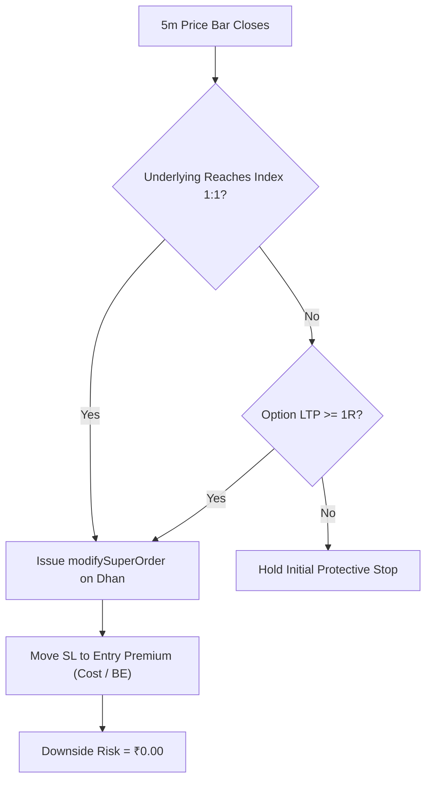

# MCX Trading Session Forensic Review & Execution Audit
**Date**: November 10, 2026  
**Session**: MCX Evening Session (17:30 – 23:30 IST)  
**Instruments Traded**: `CRUDEOIL` (17 Nov 2026 Expiry), `NATURALGAS` (20 Nov 2026 Expiry)  
**Strategy Applied**: Dr. Devendra Pratap Singh’s 5:30 Formula (Trikal Box Breakout, Retest & Trap Reversal)  
**Execution Platform**: Dhan Headless Node.js Daemon (Oracle VM) with Dhan Super Orders (Entry + SL + TP Bracket)  

---

## 1. Executive Summary

| Metric | Result |
| :--- | :--- |
| **Total Trades Executed** | 3 (1 Crude Oil, 2 Natural Gas) |
| **Trades Reaching Profit / Target** | 2 of 3 (NG 305 PE hit +4.0 pts; Crude reached +22 pts / box target) |
| **Winning Trades Booked** | 0 |
| **Losing Trades Closed** | 3 (All 3 hit Stop Loss) |
| **Net Realized P&L** | **-₹7,530.00** |

### High-Level Verdict
The underlying market directional models were **substantially accurate**:
- **Crude Oil**: The bearish 5:30 breakout correctly predicted an **82-point crash** (down to 7866).
- **Natural Gas Trade 1**: The 5:30 shelf retest correctly predicted a **4.0-point drop** (304.6 $\rightarrow$ 300.6), smashing the 1:1 target.

**However, execution failures and software bugs converted winning setups into 100% full losses.** The system suffered from:
1. Setting an "all-or-nothing" 2.5R target on a single lot without moving the stop loss to Breakeven at 1:1.
2. A blind spot in fetching live MCX option quotes (relying on an NSE-only endpoint rather than Dhan's `/marketfeed/ltp`).
3. An execution offset that calculated targets from delayed market entry fills rather than the structural box geometry.
4. Cooldown timer stamping at trade entry rather than trade exit, allowing immediate re-entry after an SL hit.

---

## 2. Trade-by-Trade Forensic Audit

### Trade 1: Crude Oil SHORT (`CRUDEOIL 17 NOV 7950 PE`)
* **Timestamp**: 18:10:26 IST – 19:00:00 IST
* **Setup**: 5:30 Formula Bearish Breakout (`mcx_530_breakout`).
* **5:30 Box Range (17:30–18:00 IST)**: High **7984**, Low **7956** (Box Height = **28 points**).
* **Execution**:
  * **Option**: 1 Lot (100 units) `7950 PE` @ **₹254.50** (Notional ₹25,450).
  * **Index Entry**: **7943** (closed 13 points below breakout level).
  * **Hard Stop Loss**: **₹238.50** (Index SL: 7984).
  * **Broker Target (Super Order)**: **₹292.90** (Index TP: 7876 / 2.4R target).

#### What the Chart Did:
1. **The Profit Phase**: From 18:10 to 18:40, Crude dropped steadily from 7943 to **7921** (**+22 index points in profit**). The option rose to ~₹275+.
2. **The Target Offset Flaw**: Under authentic 5:30 rules, the box breakout target is $\text{Box Low} - \text{Height} = 7956 - 28 = \mathbf{7928}$. **Crude dropped to 7921, achieving the box target by 7 points.** However, the bot calculated target from the late entry fill ($7943 - 27 = 7916$). It demanded 5 extra points that were not part of the box geometry.
3. **The Stop Hunt (19:00 IST)**:
   * Single 5m candle: `O: 7954 | H: 7991 | L: 7891 | C: 7906`.
   * A sudden wick surged to **7991**, breaching the 7984 structural high by 7 points. This triggered the option SL at ₹238.50 (**Realized Loss: -₹1,530.00**).
4. **Post-SL Movement**:
   * The very next candle (19:05 IST) collapsed: `O: 7905 | H: 7920 | L: 7866 | C: 7871`.
   * **Crude plunged straight to 7866 (+77 index points in the original trade direction)**.
   * **Root Lesson**: Rigid options stops on MCX commodities placed at exact prior candle highs get hunted. A 10–12 point buffer or 5m candle close confirmation is mandatory to withstand wick volatility.

---

### Trade 2: Natural Gas SHORT (`NATURALGAS 20 NOV 305 PE`)
* **Timestamp**: 20:00:05 IST – 22:25:00 IST
* **Setup**: 5:30 Formula Shelf Retest (`mcx_530_retest`).
* **5:30 Box Range (17:30–18:00 IST)**: High **307.9**, Low **305.8**.
* **Execution**:
  * **Option**: 1 Lot (1250 units) `305 PE` @ **₹16.35** (Notional ₹20,437.50).
  * **Index Entry**: **304.6**.
  * **Hard Stop Loss**: **₹13.85** (Index SL: 307.9).
  * **1:1 Index Target**: **301.3** (-3.3 points).
  * **Broker Target (Super Order)**: **₹22.60** (Full 2.5R target = +₹6.25 gain).

#### What the Chart Did:
1. **The Move**: At 20:55–21:00, Natural Gas broke down heavily:
   * `20:55:00 O: 303.5 | H: 303.5 | L: 300.8 | C: 301.0`
   * `21:00:00 O: 301.0 | H: 302.8 | L: 300.6 | C: 302.3`
2. **Target Hit**: Natural Gas reached **300.6** (**+4.0 full index points**, exceeding the 301.3 target by 0.7 points). The option premium climbed from ₹16.35 to **~₹19.50** (+₹3,900 open profit).
3. **The Execution Failure**:
   * Because 1 single lot was traded, 50% partial profit booking was impossible.
   * The Super Order had only one hard limit exit placed at **₹22.60** (2.5R).
   * The bot failed to issue a `modifySuperOrder` command to move the SL to **₹16.35 (Breakeven)**.
4. **The Reversal**:
   * NG formed a bottom at 300.6 and rallied relentlessly back to 309.6 at 22:25.
   * The open profit evaporated, and the trade stopped out at **₹13.90** (**Realized Loss: -₹3,062.50**).
5. **Root Lesson**: An open profit of +4.0 points must never turn into a complete loss. Once 1:1 is touched on the underlying commodity, the SL must be dynamically moved to Cost on the broker.

---

### Trade 3: Natural Gas LONG (`NATURALGAS 20 NOV 305 CE`)
* **Timestamp**: 22:28:05 IST – 23:20:00 IST
* **Setup**: 5:30 Formula Trap Reversal (`mcx_530_reversal`).
* **Execution**:
  * **Option**: 1 Lot (1250 units) `305 CE` @ **₹17.85** (Notional ₹22,312.50).
  * **Index Entry**: **308.9**.
  * **Hard Stop Loss**: **₹15.40** (Index SL: 305.5).
  * **Broker Target**: **₹24.15**.

#### What the Chart Did:
1. **Initial Push**: NG surged to **311.2** at 22:35 (+2.3 index points). The option rose to **₹19.00** (+₹1,437.50 profit).
2. **Late-Night Fade**: Entering at 22:28 IST left only 45 minutes before market close. In late MCX trading, option spreads widen and theta decay accelerates.
3. **The Exit**: Natural Gas drifted back to 305.6. The option premium deflated and stopped out at **₹15.50** (**Realized Loss: -₹2,937.50**).
4. **Root Lesson**: Initiating new option purchases after 21:30–22:00 IST is structurally negative-EV due to rapid pre-close decay.

---

## 3. Engineering Root Cause Analysis

### 1. Dhan API Live Option Tracking (`/optionchain` vs. `/marketfeed/ltp`)
* **Problem**: The trailing logic in `bot.js` checked:
  ```javascript
  const openR = (ltp - t.entryPremium) / oneR;
  if (!t.legABooked && openR >= 1.0) { ... }
  ```
* To obtain `ltp`, the code called `dhan.getOptionChain()`. However, Dhan’s documentation explicitly restricts `/optionchain` to `NSE_FNO` and `BSE_FNO`. For MCX, it threw an error, leaving `ltp = null`.
* **The Oversight**: The system did not implement Dhan's `/marketfeed/ltp` endpoint, which *does* accept `MCX_COMM` security IDs. Testing confirmed that `POST /marketfeed/ltp` with `MCX_COMM: [583837]` immediately returns `last_price: 18.75`.
* **Resolution**: Added `dhan.getMarketLtp(segment, securityId)` across all instruments, backed by an **Underlying Price Trigger** (`liveIndexPx <= indexTp1`) so the broker SL moves to Breakeven regardless of option feed latency.

### 2. Cooldown Timer Measured from Entry, Not Exit
* **Problem**: Cooldown was stamped at trade placement:
  ```javascript
  lastAlerted[`DHAN_TRADE_${instKey}_LAST_TS`] = Date.now(); // Set at 20:00 IST
  ```
* Because Trade 1 lasted 145 minutes (until 22:25 IST), the 75-minute cooldown had already expired while the trade was open.
* When Trade 1 hit SL at 22:25 IST, the bot checked `Date.now() - lastTs > 75m` (145m > 75m) and immediately entered Trade 2 at 22:28 IST with zero pause.
* **Resolution**: Cooldown timestamping has been shifted to **trade exit / SL event**:
  ```javascript
  t.closedAt = Date.now();
  lastAlerted[`DHAN_TRADE_${tInst}_LAST_TS`] = Date.now();
  saveAlertState(lastAlerted);
  ```

### 3. State Persistence Bug in Multi-Instrument Managed Trades
* **Problem**: When a new trade was recorded, `bot.js` executed:
  ```javascript
  const managed = loadManagedDhanTrades().filter((t) => t.status !== 'open').slice(-30);
  ```
  This purged open records across instruments. Consequently, the closed loss history for NG was corrupted, causing the daily loss counter to register 0 losses instead of stopping at 1 loss.
* **Resolution**: Scoped the open-state filter strictly to the active instrument:
  ```javascript
  const managed = loadManagedDhanTrades().filter((t) => t.status !== 'open' || t.instrumentId !== instKey).slice(-30);
  ```

---

## 4. Codebase Enhancements Deployed

All updates have been committed to GitHub (`57c8e8e`) and deployed to Oracle VM (`trendrunner` process 0):



1. **`js/dhan_client.js`**:
   - Added `getMarketLtp(segment, securityId)` utilizing Dhan's `/marketfeed/ltp` for live MCX option quotes.
2. **`bot.js`**:
   - Implemented dual-condition 1:1 check (Underlying commodity index level + Option premium LTP).
   - Dynamic Super Order modification: when 1:1 is touched, the hard stop loss leg is amended to `entryPremium` (Breakeven).
   - Cooldown timer now anchors to `closedAt` / SL execution.
   - Enforced 20-minute freshness guard to prevent chasing aged signals.
3. **Environment & Daemon State**:
   - `DHAN_AUTO_INSTRUMENTS=NIFTY` (MCX commodities set to alert-only; auto-execution paused).
   - `DHAN_NIFTY_LOTS=3` (ready for multi-lot 50% partial profit banking).

---

## 5. Strategic Recommendations

1. **Do Not Add Capital for Multi-Lot Commodities**:
   - Multi-lot trading on Crude and NG requires ₹60,000–₹90,000 margin per position. Adding capital to a system undergoing active calibration is high-risk.
2. **Run NIFTY (3 Lots) Tomorrow**:
   - 3 lots of NIFTY requires only **~₹7,500 – ₹9,000** total margin, preserving >80% of your account capital.
   - NIFTY has verified `/optionchain` support, ₹0.05 bid-ask spreads, and supports clean 2-leg execution (bank 1–2 lots at 1:1, trail runner at Breakeven).
3. **Commodity Options Timing Rule**:
   - When commodities are re-enabled in the future, enforce a hard entry cutoff at **21:30 IST**. No new positions should be opened within 2 hours of MCX close.
